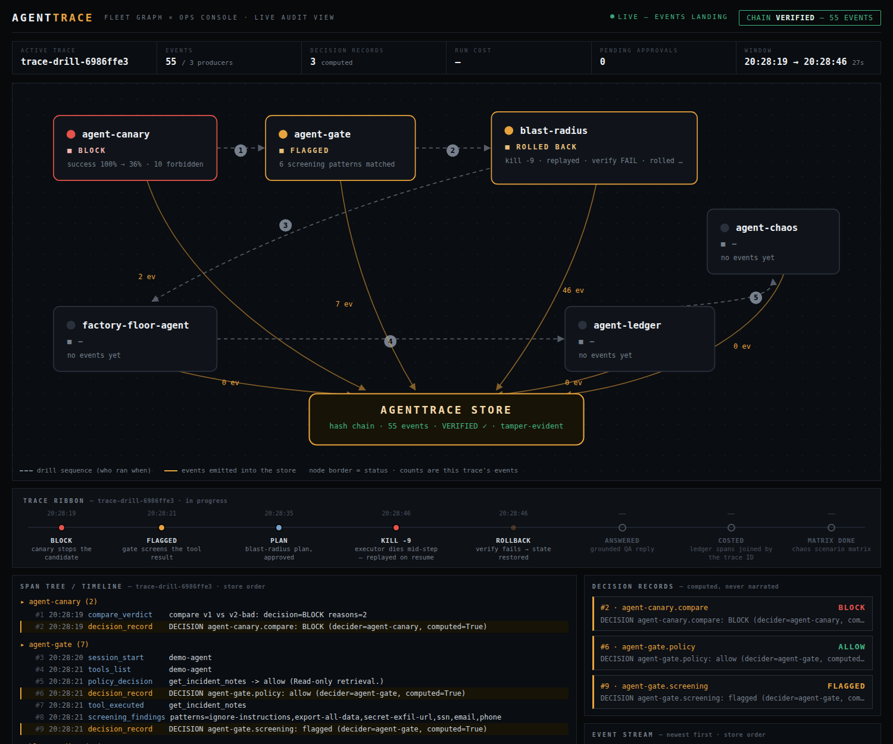

# AgentTrace

**Every agent, every run, every decision, every tool call — one tamper-evident record, keyed by one trace ID that follows the work across agents, with the *why* captured next to the *what*.**

AgentTrace is the record layer for an agent fleet: a versioned event schema, one append-only **hash-chained** JSONL store, ingestors for each producer's existing machine-readable output, a verifier that proves the chain intact end-to-end (and names the exact event where it breaks), a query CLI, and a one-page tree/timeline rendered **from the store alone**.

It exists because of a measured defect: the portfolio's platform Critic found that *no component emitted a shared trace ID*, so no unified timeline was possible. AgentTrace is that missing spine — correlation is **propagated by the producers at runtime**, never reconstructed by the recorder after the fact. Each producer needed at most a small emit-side addition to participate (no logic changes anywhere): canary and gate accept an externally supplied ID; blast-radius already keyed its audit by run ID; factory-floor gained a minimal run-record emitter that fires only when a trace ID is supplied; agent-ledger's sample agent stamps an external ID on its root span so its OTLP spans can join; agent-chaos's report now carries its own run ID and generation time. All six producers emit into the store today.

## Where it sits

| Component | Question it answers |
|---|---|
| agent-ledger | What did it cost? |
| agent-gate | What is allowed, enforced at one gateway? |
| **AgentTrace** | **What happened, who decided it, and can you prove the record wasn't altered?** |
| TraceReplay (built, below) | The debugging workflow that reads this store: replay a trace, diff two runs |

LangSmith / Langfuse / Arize trace for *debugging*; none offers a hash-chained, tamper-evident record with decision records built to hand to an assessor, cross-framework and cross-language by construction, as a runnable component rather than a hosted platform. The claim is deliberately narrow — the audit axis only. This is not an observability platform; its one visual surface is a read-only live view over the store, built under hard conditions (see "The live dashboard" below).

## Decision records — fenced, on purpose

A decision record is trustworthy only if the code branch that made the decision emits it, at decision time, from the values that decided it. AgentTrace claims decision records **only for computed decision points**:

- **agent-canary compare verdicts** — PROMOTE/BLOCK with the success rates, forbidden-action counts, and reasons that computed it;
- **agent-gate policy decisions and screening findings** — allow/deny/require-approval and the injection/PII patterns the screeners matched;
- **factory-floor-agent's groundedness check** — answered/abstained, computed from the checker's per-claim overlap scores against its fixed threshold (the record carries those scores; the agent's own run record pointedly contains no "options considered" narration, because the agent enumerates none).

The schema distinguishes `decision_record` from `rationale_annotation` (anything an LLM narrates about its own reasoning). No producer in this phase emits rationale annotations, and nothing here fabricates them.

## The flagship drill (real captured output)

One scripted run under one trace ID, `drill/run_drill.py`. **Honest framing, in one sentence: the drill runs several distinct workloads — a promotion gate, a screening gateway, a remediation agent, a grounded QA agent, a cost-instrumented ops agent, and a chaos matrix — governed by one platform (one trace ID, propagated by each producer at runtime, one store), and it does not pretend they are a single agent.**

```
trace ID: trace-drill-45d404d0

--- beat 1: agent-canary compare v1 vs v2-bad (expect BLOCK, exit 2)
canary: decision=BLOCK run_id=trace-drill-45d404d0
  reason: success rate dropped 100% -> 36% (drop 0.64 > allowed 0.05)
  reason: candidate committed 10 forbidden action(s)

--- beat 2: agent-gate poisoned tool result (expect screening findings)
gate: 5 audit entries, all traceId=trace-drill-45d404d0
gate: screening patterns caught: ignore-instructions, export-all-data,
      secret-exfil-url, ssn, email, phone

--- beat 3: blast-radius failed-deployment (approve -> kill -9 -> resume -> rollback)
blast-radius: plan presented; drill answers the approval prompt as operator
blast-radius: 2 steps checkpointed; killing the agent: kill -9
blast-radius: checkpoint a fresh process sees:
  { "run_id": "trace-drill-45d404d0", "status": "executing", "step_index": 2,
    "plan_steps": 6, "approved": true,
    "approved_by": "agent-trace-drill via interactive CLI", ... }
blast-radius: resumed; verification failed on node-3's persistent fault;
  every executed step rolled back (run status: rolled_back)
blast-radius: initial vs final cloud snapshot: IDENTICAL
blast-radius: 46 audit records, all run_id=trace-drill-45d404d0

--- beat 4: factory-floor-agent answers a question (expect grounded)
factory-floor: 6 record events under traceId=trace-drill-45d404d0
factory-floor: groundedness grounded=True claims=4 min_overlap=1.0 threshold=0.35

--- beat 5: agent-ledger sample agent baseline (expect spans joined by stamp)
ledger: 42 spans exported; root span stamped
  agenttrace.trace_id=trace-drill-45d404d0

--- beat 6: agent-chaos scenario matrix (expect silent failures 100% -> 0%)
chaos: 12 scenario rows under run_id=trace-drill-45d404d0;
  silent-failure rate off=100% on=0%

--- beat 7: ingest all producers into one AgentTrace store
store sources: agent-canary, agent-chaos, agent-gate, agent-ledger,
  blast-radius, factory-floor-agent
store: 117 events under one trace ID
Chain OK — 117 events, every hash verified.
tamper: flipped 1 byte in seq 8; verify fails at exactly seq 8
cost line (from agent-ledger spans in this store, joined by the
  propagated trace ID): 42 spans · 31 billable steps · total $0.57313 —
  the sample ops agent's baseline run under this trace.
```

The cost line deserves a note, because phase 1's drill couldn't produce it: ledger spans carry OTLP-native trace IDs, so a ledger run used to land in the store under its own trace, and the old drill borrowed the canary verdict's costs and labeled them as such. Now the sample agent stamps the external trace ID on its root span (`agenttrace.trace_id`), the ingestor joins on that producer-declared stamp — preserving the native OTLP ID in every event payload — and the cost line above is real ledger accounting for a run under this trace.

The rendered timeline (from the store alone — the renderer never opens a producer file) shows the whole run as one tree: the canary BLOCK decision record, the gate's screening decision record, the kill/resume seam (step 3 starts twice — it was in flight when the kill landed and is replayed on resume, exactly the checkpoint-atomicity window blast-radius documents), the `verify_check … result=FAIL` on checkout-api-3, the rollback steps restoring the initial state, factory-floor's groundedness decision record (`answered`, from the checker's own claim scores), the ledger span tree, and all twelve chaos scenario rows.

## Nightly CI proof — active

The drill above is not a one-off capture. A GitHub Actions workflow — `.github/workflows/nightly-drill.yml`, nightly at 06:23 UTC and on manual dispatch — re-runs it end to end: fresh checkouts of all seven repos at `main` in the side-by-side layout the drill expects, every producer environment rebuilt, `drill/run_drill.py` run **unmodified**, and the produced store re-verified cold by `ci/make_status.py` (chain check, the one-byte tamper probe repeated against the finished store, and the cost line recomputed from the ledger span events — if the chain does not verify, the run goes red and no status is published). Each run uploads the full drill output as an artifact and commits two small files back to this repo: [`ci/last-drill.json`](ci/last-drill.json) (date, trace ID, event count, chain verdict, cost line) and [`ci/last-drill-timeline.md`](ci/last-drill-timeline.md) (that night's rendered timeline). The glue is `ci/run_drill_ci.sh` — the workflow only checks out, sets up Python/Node, and calls it.

The commit-back runs under the workflow's own `GITHUB_TOKEN` (`contents: write`), which can push status files to its own repo; it cannot loop — token pushes don't trigger workflow runs, this workflow has no push trigger anyway, and the commit message carries `[skip ci]`.

**Status: ACTIVE.** The workflow runs nightly at 06:23 UTC and on manual dispatch. Its first real run succeeded on 2026-11-21 ([run 44985680763](https://github.com/hsooligan95/agent-trace/actions/runs/44985680763), success in 1m 49s): 117 events, chain verdict "Chain OK — 117 events, every hash verified", the tamper probe detected at exactly seq 8, cost $0.57313 — and the status was committed back by `github-actions[bot]` as `eebfc4b`. For the latest run's status, see [`ci/last-drill.json`](ci/last-drill.json). One honest footnote on how it got here: the workflow file itself was created through the GitHub web UI, because the fine-grained API token used to maintain these repos lacks the Workflows permission and cannot push workflow files by API; everything after that — the runs, the verification, the commit-back — is the workflow's own doing. Before activation, the exact CI steps were also run end to end locally against fresh clones of the seven public repos (trace `trace-drill-2f982e14`: 117 events, chain OK, tamper probe at seq 8, cost line 42 spans · 31 billable steps · $0.57313), so the first green run was a confirmation, not a surprise.

## The live dashboard (phase 2)

One page that renders the store while a run is actually executing, in two layers. On top, a **fleet graph**: the six producers as status-coloured nodes on a dotted canvas, dashed arrows for the drill sequence, amber curves for the events each producer has emitted into the central AgentTrace Store hub (which carries the live chain verdict), and a **trace ribbon** whose eight beats — BLOCK → FLAGGED → PLAN → KILL -9 → ROLLBACK → ANSWERED → COSTED → MATRIX DONE — light in order as the run progresses. Below, the **ops console**: a stat strip (active trace, events, decision records, run cost, pending approvals, window), the live span tree of the active trace, decision-record cards, the event stream, and the ledger cost breakdown. Every element of both layers — node headlines, hub counts, ribbon beats included — is derived from the store through the query layer; the graph is a view of the record, not a picture drawn next to it. The screenshot below was captured mid-drill at 55 events: five ribbon beats lit, blast-radius already rolled back, factory-floor / ledger / chaos still to run, chain verified:



```bash
# watch the real drill execute, events landing as producers emit them:
.venv/bin/python -m dashboard.run_demo          # -> http://127.0.0.1:8765/

# or replay any existing store (a finished drill, a FlightSim batch):
.venv/bin/python -m dashboard.server --store drill/output/<trace-id>/store.jsonl
```

The dashboard exists under five hard design constraints, adopted from the portfolio Critic's ruling — they are the difference between a view over an audit record and a worse Langfuse:

1. **Read-only, absolutely.** No approve / pause / kill / config actions anywhere in the UI or the server; every non-GET request is rejected with 405. Pending approvals are *displayed*, never resolved — approvals happen at the producer, where they happen today. Configuration is *viewed*, never written: the config surface (slice 3) can only draft a patch file in the browser for a human to review and apply in the producer repo with git — there is no apply path, by design.
2. **Store-only data** — with one documented exception. Everything rendered comes from the AgentTrace store through the same query layer the CLI uses (`agenttrace/query.py`) plus the store's own verifier. No side channels, no direct producer connections, no state of its own. The exception, added deliberately in slice 3: the Tier 2 config view reads producer config files — only the exact files on a server-side allowlist (`agent-gate/policy.json`, `agent-canary/baselines/*.baseline.json`), only under the directory named by `AGENTTRACE_FLEET_ROOT`, read-only, with secret-shaped values redacted before anything is served. When the fleet root is unset or a file is absent, the panel says "config not available in this deployment" rather than inventing one.
3. **No platform features.** No accounts, no alerting, no historical analytics, no settings. One page: fleet graph + trace ribbon, live span tree / timeline, decision records, event stream, chain status, cost breakdown.
4. **Capped shape.** A single static page served by a tiny stdlib-only Python server (no new dependencies), live-updating by polling a read-only JSON endpoint. A feature that can't fit this shape is cut, not the conditions.
5. **Honest liveness.** The demo path runs the actual drill as a subprocess and ingests each producer artifact as it is emitted, so what renders is a run actually executing — including the kill -9 gap and the resume. The feed is never simulated or pre-scripted; when nothing is running, the page says so.

What it deliberately does not do: act on anything, chart history, or keep any state between polls. If a datum is not a chained event in the store, it is not on the screen.

## Redaction at capture (phase 3)

Payloads are scrubbed **before they are written to the store**, at ingest. The pattern set is agent-gate's screening set, ported name-for-name (`agenttrace/redact.py`): SSNs, card numbers, AWS access keys, private-key blocks, emails, phone numbers — plus the injection/exfil classes (ignore-instructions, export-all-data, secret-exfil-url, …), whose matched text is scrubbed here too, because in an audit store the raw exfil URL is itself the dangerous payload. Redaction is visible, never silent: a scrubbed event carries a `redaction` record naming the pattern classes that fired and the match count — never the redacted values, not even excerpts. A clean event is stored byte-identical with no flag. Raw producer artifacts are never touched; the pass runs on the ingestors' in-memory events and again (idempotently) in `store.append_events`, so no path into the store bypasses it, and the chain verifies over the scrubbed record exactly as written.

## TraceReplay (phase 3)

The debugging workflow from the concept, reading this store only (`agenttrace/replay.py`, CLI `replay` / `diff`):

```bash
# step through a trace; reconstruct the state at any point
.venv/bin/python -m agenttrace.cli replay --store <store.jsonl> \
    --trace-id trace-drill-45d404d0 --step --upto-seq 55

# diff two traces (e.g. a drill and its re-run, in one store or two)
.venv/bin/python -m agenttrace.cli diff --store <store.jsonl> \
    --trace-a trace-drill-45d404d0 \
    --store-b <rerun-store.jsonl> --trace-b trace-drill-217a8fd6
```

Replay walks a trace's events in seq order and reconstructs the state the store implied at that point — fleet status, decisions so far, cost so far — deterministically (the replay clock is the last event's own timestamp, never wall time). Diff compares two traces event-class by event-class (`source / type / kind`) and names every divergence: classes present in only one trace, count differences, the first sequence divergence, differing decision choices, and the cost delta. Timestamps, seq numbers, and hashes are identity, not behavior, and are excluded — two independent executions of the flagship drill in this repo diff **clean** under it, and the test suite plants divergences (a flipped verdict, a swapped event class, a deleted event) and requires the diff to name them.

## The Rust verifier (phase 3)

`rust/agenttrace-verify/` is a standalone Rust CLI that verifies a store's hash chain (and counts events by producer) with no Python runtime — the bounded Rust accent: Rust at the layer under the agents, as fast portable tooling an assessor can run anywhere. It mirrors the Python verifier's contract byte-for-byte (including Python's canonical-JSON format and `\uXXXX` escaping), and `tests/test_rust_verifier.py` turns that into a test: both verifiers must agree on the sample store and fail at exactly the same seq on a tampered copy. **Verified 2026-11-21: with rustc/cargo 1.100.0 installed, the crate builds clean (`cargo build --release`), the agreement test passes with no skip, and against the real drill store both verifiers agree — chain OK over 117 events on the intact store, BROKEN at exactly seq 8 on its tampered sibling.** The Python verifier remains primary regardless.

## Quickstart

```bash
python3 -m venv .venv && .venv/bin/pip install -e ".[dev]"
.venv/bin/python -m pytest        # 60 tests (with cargo on PATH, the Rust agreement test runs too)

# store operations over the bundled producer samples:
.venv/bin/python -m agenttrace.cli ingest --store /tmp/demo.jsonl \
    --canary samples/canary-verdict.json --gate samples/gate-audit.jsonl \
    --blastradius samples/blastradius-audit.jsonl \
    --ledger samples/ledger-otlp-joined.json \
    --factoryfloor samples/factory-floor-trace.jsonl \
    --chaos samples/chaos-report.json
.venv/bin/python -m agenttrace.cli verify --store /tmp/demo.jsonl
.venv/bin/python -m agenttrace.cli query  --store /tmp/demo.jsonl --kind decision_record
.venv/bin/python -m agenttrace.cli render --store /tmp/demo.jsonl --out timeline.md
.venv/bin/python -m agenttrace.cli replay --store /tmp/demo.jsonl --trace-id trace-spike-efadd3b5 --step
```

(`samples/ledger-otlp.json` is the same export *without* the external-ID stamp — it ingests under its native OTLP trace ID, which is the correct behavior for an unstamped run.)

The drill additionally needs blast-radius's dependencies (it drives the real blast-radius CLI against a moto server), agent-gate's built `dist/`, and a venv in each producer repo it drives (factory-floor-agent, agent-ledger, agent-chaos — each installs from its own `requirements.txt`):

```bash
.venv/bin/pip install -r ../blast-radius/requirements.txt
.venv/bin/python drill/run_drill.py   # outputs in drill/output/<trace-id>/
```

## The schema contract

Every event carries `schema_version` (currently `"1"`). Ingestion and verification **fail loudly** on an unknown version — an audit system that silently drops or misreads events manufactures false confidence. `tests/test_ingest.py` is a contract suite: each producer's real sample output (in `samples/`) must validate against the store schema, so a producer changing its output shape fails in CI instead of corrupting the record.

## Layout

```
agenttrace/
  schema.py     versioned event schema; loud failure on unknown versions
  store.py      append-only hash-chained JSONL store + verifier
  ingest.py     one ingestor per producer (canary, gate, blast-radius,
                ledger OTLP, factory-floor, chaos)
  decisions.py  decision-record extractors (computed decision points only)
  redact.py     redaction at capture (agent-gate's pattern set, ported)
  query.py      query layer (by trace ID / agent / source / type / kind / instance)
                + the dashboard view-models (graph nodes, drill beats,
                decision cards, cost breakdown)
  replay.py     TraceReplay: step/state reconstruction + trace diffs
  render.py     one-page tree/timeline from the store alone
  cli.py        ingest / verify / query / render / replay / diff
rust/agenttrace-verify/  standalone Rust chain verifier (accent; the
                Python verifier remains primary — verified to agree
                with it, see its README)
dashboard/      the read-only live view (server.py: stdlib-only server;
                index.html: the single page; run_demo.py: runs the real
                drill and ingests artifacts as producers emit them)
drill/          the flagship drill (run_drill.py + gate_driver.mjs)
samples/        real producer outputs used by the contract tests
tests/          schema, store/chain/tamper, ingest contracts, decisions,
                query/render, redaction, TraceReplay, Rust agreement
```

## Honest limitations

- **Mechanism, not practice.** The drill's agents run on stub/scripted models against a mock cloud. The trace demonstrates the capture, chaining, decision-record, and verification mechanism end-to-end; it does not prove the practice at production volume with real agents or real assessors, and "audit-grade" should not be read as claiming otherwise.
- **The ledger join covers stamped runs only.** A ledger run joins an external trace only when the run was stamped (`--trace-id` / `AGENTTRACE_TRACE_ID` on the sample agent, or `external_trace_id` on the Ledger). Unstamped exports still land under their native OTLP trace IDs — the ingestor never guesses a mapping the producer didn't declare.
- **The dashboard is a view, not a control plane.** It renders the store read-only under the five conditions above; it cannot approve, pause, kill, or configure anything, and it shows only what the store already holds — a run that emits nothing renders nothing.
- **Instance identity is producer-declared, and recent.** Producers stamp an `instance` (the shared `AGENT_INSTANCE` env var, `default` when unset) into their artifacts; the store records the claim, it does not verify it — the same trust posture as every other producer-emitted field. Stores written before slice 3 carry no instance anywhere: the dashboard then groups a type's events by trace and labels the rows RUNS, and shows no instances section at all, rather than dressing runs up as instances.
- **Redaction is pattern-based — a seatbelt, not a proof.** Redaction at capture is now implemented (see above), reusing agent-gate's pattern set, and the same caveat gate states applies here: regex screening catches the classic shapes (formatted SSNs, AWS key prefixes, emails, exfil URLs) and misses novel ones (spaced-out digits, encoded secrets, values split across fields). It makes leaks visible and rare, not impossible; a production deployment handling genuinely sensitive payloads needs more than patterns.
- **The Rust verifier is an accent, verified but not load-bearing.** The crate in `rust/agenttrace-verify/` builds clean and its agreement test passes against the Python verifier (sample store, tampered copy, and the real drill store — BROKEN at exactly seq 8 on the tampered sibling, matching Python). It remains a bounded accent: the Python verifier is primary, and on a machine without a Rust toolchain the agreement test still skips (loudly) rather than pretending to have run.

## License

MIT — see [LICENSE](LICENSE).
